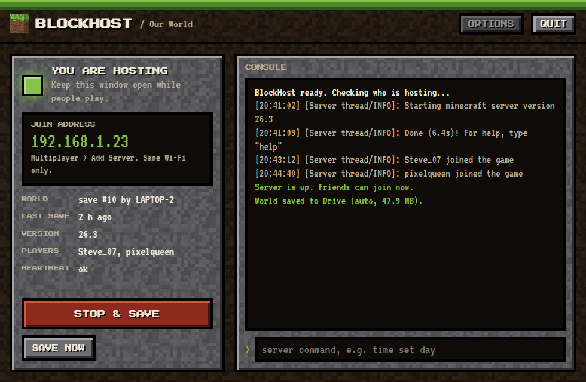

<div align="center">

# BlockHost

**One shared Minecraft world. Any friend can host it, even when you're not around.**

A small desktop launcher for Windows and macOS. A friend group takes turns hosting the same Minecraft Java world on their home network.
The world lives (encrypted) in one Google Drive, and a lock makes sure only one laptop hosts at a time.



</div>

---

## The problem

"Open to LAN" only works while the person who owns the world is online. A dedicated server needs a computer that's always on.
Copying the world folder around by hand works until two people play different copies on the same day and one of them is lost.

## How BlockHost solves it

```
            Google Drive (owner's account, app-only folder)
        ┌────────────────────────────────────────────────────┐
        │ state.json   state · gen · host · IP · heartbeat   │
        │ world-A.bhw  current save (AES-256 encrypted)      │
        │ world-B.bhw  previous save                         │
        └───────▲──────────────────────────────▲─────────────┘
       claim / heartbeat / save        "who's hosting?"
                │                              │
     ┌──────────┴──────────┐        ┌──────────┴──────────┐
     │ Laptop A (hosting)  │◄──LAN──│ Laptop B (joining)  │
     │ runs the server     │        │ joins 192.168.x.x   │
     └─────────────────────┘        └─────────────────────┘
```

1. **START HOSTING** reads `state.json`. If someone else is hosting, BlockHost shows who they are and their address so you can join them instead.
2. Otherwise it **claims** the server: it sets `state=running`, adds one to `gen`, and writes a random `nonce`. It waits a few seconds and reads the file again. If two people clicked at the same moment, only one keeps the claim.
3. The world is downloaded, decrypted and run **from a local copy**. Drive never touches the live files.
4. A **heartbeat** runs on its own thread, so it never slows the game. It refreshes `state.json` every minute. If a host's laptop dies, the claim is treated as abandoned after 10 minutes and someone else can take over.
5. **Mid-game saves** pause world saving for about a second, copy the world, then turn saving back on. Only the copy is compressed, encrypted and uploaded.
6. **STOP & SAVE** (or closing the window) stops the server, uploads the final world and releases the lock.
7. **Fencing:** a host that comes back after being taken over can't overwrite the newer world. Its late save is kept as a separate `CONFLICT` file instead.

## Features

- 🔒 One host at a time, with protection against two people clicking START together, crashed hosts and late saves
- 💓 Heartbeat and stale-host takeover
- 🔐 AES-256-GCM encrypted world, plus a password-sealed group file
- 🗂️ Only 2 saves kept (current + previous), so Drive storage doesn't fill up, and a one-click restore of the previous save
- 🧱 Downloads the official server `.jar` from Mojang and checks its hash
- ☕ Offers to install Java if it's missing
- 🛡️ Safe close: the window's X and QUIT both save before exiting. If the launcher crashes, the server is stopped too.
- 🖥️ Windows and macOS

## Quick start

**Friends (joining a group)**
1. Download BlockHost for your system from **Releases**.
   - **Windows:** if SmartScreen warns you, click *More info → Run anyway*.
   - **macOS:** right-click the app → *Open* → *Open* (only the first time).
2. Click **JOIN GROUP**, pick the `.bhgroup` file the group owner sent you, and type the group password.
3. To play: click **START HOSTING**, or join the address that BlockHost shows.

**Group owner (one time, about 15 min, free):** follow [docs/OWNER-SETUP.md](docs/OWNER-SETUP.md).

## Security model

| What | How it's protected |
|---|---|
| Your Google Drive | The app uses the `drive.file` scope, so it can only see the files it created itself. |
| World saves | AES-256-GCM, with a random key that exists only inside the group file. A leaked Drive link is useless on its own. |
| Group file | Sealed with the group password (scrypt + AES-GCM). |
| Saved login on each laptop | Windows DPAPI or the macOS Keychain. |
| Network | The Windows firewall rule is limited to Private networks. Nothing is exposed to the internet. |

Anyone with **both** the group file and the password can host. To remove someone from the group, create a new group.
See [SECURITY.md](SECURITY.md) to report a vulnerability.

## FAQ

<details><summary>Does it work over the internet, not just on LAN?</summary>
BlockHost doesn't open ports to the internet. For friends outside your home, put everyone on a free private network such as Tailscale and share the Tailscale address.
</details>

<details><summary>What is "online mode"?</summary>
With online mode on (the default), players must own Minecraft and are verified by Mojang. Turn it off only for a trusted LAN: anyone who can reach the server can join under any name.
</details>

<details><summary>Can I import an existing world?</summary>
Not from the UI yet (see the roadmap). For now: host once, stop, then copy your world into the <code>server/world</code> folder of BlockHost's local data folder on the host laptop and host again.
</details>

<details><summary>Why Google Drive and not GitHub / Dropbox / S3?</summary>
Drive gives free storage, a narrow per-app permission and resumable uploads. The storage layer is a single file (<code>app/core/drive.py</code>), so other backends are welcome as contributions.
</details>

## Development

```bash
python -m venv .venv
.venv/Scripts/pip install -r requirements-build.txt    # Windows (macOS: .venv/bin/pip)
python app/main.py                                     # run from source
python tests/test_logic.py                             # lock/crypto tests, no Google account needed
python tests/test_logic.py --e2e                       # also boots a real Minecraft server (needs Java 25)
./build.sh   or   build.bat                            # package the app
```

```
app/
  main.py          window + bridge between UI and Python
  core/session.py  claim, heartbeat, fencing, world sync, safe stop
  core/drive.py    minimal Google Drive REST client (OAuth loopback + PKCE)
  core/crypto.py   streamed AES-GCM archives, password-sealed group file
  core/mcserver.py server.jar download, process control, snapshots
  core/system.py   everything that differs between Windows and macOS
  ui/              HTML/CSS/JS interface (procedural pixel art, open fonts)
site/              homepage + privacy-policy template required by Google
tests/             offline test suite (fake Drive)
```

CI runs the full test suite, including a real Minecraft server, on Windows and macOS, and builds all three binaries.

## Roadmap

- [ ] Import an existing world from the UI
- [ ] Optional Tailscale address display for remote friends
- [ ] More storage backends (S3-compatible, WebDAV)
- [ ] Paper/Fabric server support

## Contributing

PRs and issues are welcome. Start with [CONTRIBUTING.md](CONTRIBUTING.md).

## License & credits

[MIT](LICENSE). Fonts: *Press Start 2P* and *VT323*, under the SIL Open Font License (`app/ui/fonts/`).
All artwork is generated procedurally in code.

**BlockHost is not an official Minecraft product and is not approved by or associated with Mojang or Microsoft.**
Running a Minecraft server requires accepting the [Minecraft EULA](https://aka.ms/MinecraftEULA).
